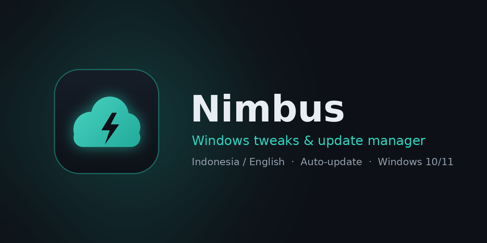

<p align="center">
  
</p>

<p align="center">Tweak Windows dan atur Windows Update dengan tampilan yang lebih nyaman.<br/>
Bahasa Indonesia &amp; English · Tema gelap teal · Efek transparan Windows 11 · Auto-update dari GitHub</p>

<p align="center"><a href="https://github.com/RoocHelper/Nimbus/releases/latest"><b>⬇ Unduh versi terbaru</b></a></p>

---

Nimbus adalah aplikasi desktop (C# / WPF, .NET 8) yang mengambil bagian **Tweaks** dan **Updates** dari
[WinUtil karya Chris Titus Tech](https://github.com/ChrisTitusTech/winutil), lalu membungkusnya dengan antarmuka baru.
Daftar tweak dan skrip PowerShell-nya tetap memakai milik WinUtil (lisensi MIT), jadi perilakunya sama persis.

## Fitur

| Halaman | Isi |
|---|---|
| **Beranda** | Tombol *Optimalkan* sekali klik (preset Minimal / Standard / Advanced), jumlah tweak aktif, mode update, info sistem |
| **Tweaks** | Essential · Advanced · Preferensi (toggle langsung) · DNS · Performa (Ultimate Performance, O&O ShutUp10++) · Aplikasi bawaan (hapus / pasang ulang AppX) |
| **Updates** | Mode Windows Update (Rekomendasi / Bawaan / Matikan), perbaikan Windows Update, dan pembaruan Nimbus |
| **Riwayat** | Semua perubahan + log, dengan tombol *Urungkan* |
| **Setelan** | Bahasa ID/EN, efek jendela Acrylic / Mica / Solid, restore point otomatis, cek update otomatis |

Keamanan:
- Restore point dibuat otomatis sebelum menerapkan tweak (bisa dimatikan di Setelan).
- Setiap tweak diberi label **Aman / Hati-hati / Berisiko** dan konfirmasi sebelum dijalankan.
- Tweak yang sudah aktif di PC terdeteksi otomatis (badge *Aktif*).

## Menjalankan dari source

Butuh Windows 10/11 dan [.NET 8 SDK](https://dotnet.microsoft.com/download/dotnet/8.0).

```powershell
cd "D:\sopware\AI Research\Nimbus"
.\build.ps1              # build lalu jalankan
.\build.ps1 -Publish     # build lengkap (self-contained) ke folder .\publish
```

Atau buka `Nimbus.sln` di Visual Studio 2022 lalu tekan F5. Nimbus akan meminta izin administrator (UAC) saat dibuka.

## Membuat file .exe

Klik dua kali **`build-exe.cmd`**. Hasilnya `dist\Nimbus.exe`: satu file yang bisa langsung dijalankan di PC lain
tanpa perlu memasang .NET (ukurannya sekitar 70 MB karena .NET ikut dibundel).

Setiap rilis di GitHub juga otomatis berisi dua pilihan:

| File | Untuk siapa |
|---|---|
| `Nimbus-win-Setup.exe` | Installer. Membuat shortcut di Start Menu dan **mendapat update otomatis**. Disarankan untuk pengguna biasa. |
| `Nimbus-Portable.exe` | Satu file tanpa install. Cocok untuk dibawa di flashdisk, tetapi **tidak update otomatis** (unduh ulang dari GitHub). |

## Auto-update lewat GitHub

Nimbus memakai [Velopack](https://velopack.io). Setiap rilis di GitHub berisi `Nimbus-win-Setup.exe` dan paket update.
Aplikasi yang terpasang akan memeriksa halaman Releases, menampilkan badge **Update tersedia**, lalu mengunduh dan membuka ulang dirinya sendiri.

### Sekali saja: siapkan repository

Alamat update sudah diatur ke **https://github.com/RoocHelper/Nimbus** (di `src/Nimbus/Services/AppInfo.cs`).
Semuanya bisa dilakukan dari website GitHub:

1. Buat repository **public** bernama `Nimbus` di akun `RoocHelper`.
2. Upload isi folder `UPLOAD-KE-GITHUB` lewat **Add file → Upload files**.
3. Buka `tools/release.yml` → ikon pensil → ubah nama file menjadi `.github/workflows/release.yml` → **Commit changes**.

### Setiap kali merilis versi baru (dari website)

1. (Opsional) Edit `release-notes.md` di GitHub (ikon pensil). Isinya tampil di dialog update.
2. Buka tab **Actions** → **Release** → **Run workflow** → isi versi, misalnya `1.0.1` → **Run workflow**.
3. Tunggu 5–10 menit. Rilis baru muncul di tab **Releases** berisi `Nimbus-win-Setup.exe` dan `Nimbus-Portable.exe`.

Nomor versi harus selalu naik (1.0.1, 1.0.2, 1.1.0, …). Pengguna yang memasang lewat Setup.exe akan otomatis
melihat notifikasi **Update tersedia**.

Kalau kamu memakai git, push tag `v1.0.1` juga memicu rilis yang sama.

> **Catatan SmartScreen:** tanpa sertifikat code signing, Windows bisa menampilkan "Windows protected your PC"
> saat Setup.exe pertama kali dibuka. Pengguna klik **More info → Run anyway**. Antivirus juga kadang menandai
> tool yang mengubah registry. Sertifikat code signing akan mengurangi peringatan ini.

## Memperbarui daftar tweak dari WinUtil

```powershell
.\tools\sync-winutil.ps1
```

Skrip ini mengunduh `tweaks.json`, `dns.json`, `preset.json`, `appx.json`, dan fungsi PowerShell terbaru dari WinUtil,
lalu memberi tahu jika ada fungsi pembantu baru yang belum tersedia di Nimbus. Tambahkan juga terjemahan untuk tweak baru di
`src/Nimbus/Data/i18n/id.json` (tanpa terjemahan, teks bahasa Inggris dipakai).

## Struktur proyek

```
src/Nimbus/
  Data/                tweaks.json, dns.json, preset.json, appx.json (WinUtil) + i18n/id.json
  Scripts/             NimbusShim.ps1 + fungsi PowerShell WinUtil
  Localization/        Strings.id.xaml, Strings.en.xaml
  Themes/              warna dan gaya kontrol
  Services/            konfigurasi, PowerShell runner, deteksi status, auto-update
  ViewModels/, Views/  halaman Beranda, Tweaks, Updates, Riwayat, Setelan
```

Cara kerjanya: Nimbus membaca `tweaks.json` untuk menampilkan daftar, lalu menjalankan Windows PowerShell 5.1 dengan
fungsi WinUtil yang sama (`Invoke-WinUtilTweaks`, `Invoke-WPFUpdatessecurity`, dan lainnya) saat kamu menekan Terapkan.

Data pengguna (setelan, riwayat, log) disimpan di `%AppData%\Nimbus`.

## Lisensi

Nimbus: MIT (lihat `LICENSE`). Data dan skrip WinUtil: MIT, © Chris Titus Tech (lihat `THIRD_PARTY_NOTICES.md`).
Nimbus adalah proyek independen dan tidak berafiliasi dengan Chris Titus Tech.
